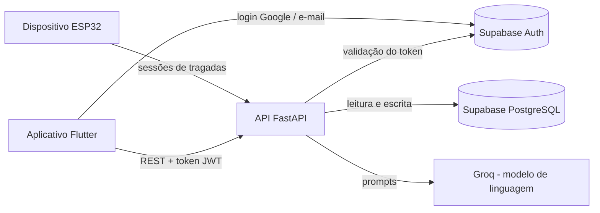

# O₂Eight

Ecossistema de hardware e aplicativo móvel para apoio à cessação do tabagismo.

O O₂Eight combina um dispositivo físico baseado em ESP32, sem nicotina ou qualquer outra substância, com um aplicativo que transforma cada interação do usuário em indicadores de progresso. O objetivo é atacar duas barreiras conhecidas do processo de parar de fumar: o ritual comportamental do cigarro e a falta de resultados visíveis no curto prazo.

## Sumário

- [Contexto](#contexto)
- [Objetivos](#objetivos)
- [Funcionalidades](#funcionalidades)
- [Arquitetura](#arquitetura)
- [Tecnologias](#tecnologias)
- [Estrutura do repositório](#estrutura-do-repositório)
- [Como executar](#como-executar)
- [Status do projeto](#status-do-projeto)
- [Privacidade e uso responsável](#privacidade-e-uso-responsável)
- [Equipe](#equipe)

## Contexto

O tabagismo é a principal causa evitável de adoecimento e morte no mundo e responde por mais de 7 milhões de mortes por ano, segundo a Organização Mundial da Saúde. No Brasil, 9,3% dos adultos das capitais se declararam fumantes em 2023 (Vigitel). Embora a maioria dos fumantes deseje parar, grande parte das tentativas sem apoio termina em recaída: a dependência envolve componentes físicos, psicológicos e comportamentais, e os benefícios da cessação demoram a se tornar perceptíveis.

A fundamentação completa, com referências, está no artigo do projeto.

## Objetivos

**Objetivo geral:** desenvolver um ecossistema de hardware e software que apoie pessoas no processo de parar de fumar, oferecendo um substituto para o gesto da tragada e retorno visual imediato sobre o progresso.

**Objetivos específicos:**

- Construir um dispositivo sem nicotina, baseado em ESP32, que detecte e registre cada tragada simulada em tempo real.
- Implementar uma API para receber, armazenar e processar esses eventos.
- Desenvolver um aplicativo que calcule a economia financeira, apresente marcos de recuperação da saúde e identifique os principais gatilhos do usuário.
- Oferecer um assistente conversacional com inteligência artificial para os momentos de fissura.
- Oferecer uma comunidade de apoio entre usuários.

## Funcionalidades

| Funcionalidade | Descrição |
|---|---|
| Autenticação | Login com Google (OAuth) ou com e-mail e senha, via Supabase Auth |
| Onboarding | Formulário inicial sobre o hábito de fumar: tempo, quantidade, tipo, gastos, gatilhos, motivações e histórico familiar |
| Painel de progresso | Dias sem fumar e dinheiro economizado, calculados a partir do formulário e da data da última recaída |
| Assistente com IA | Chat que usa o perfil do usuário e o histórico da conversa para apoiar nos momentos de vontade |
| Dispositivo simulador | ESP32 com sensor de pressão; cada tragada no dispositivo simula um cigarro fumado e mostra no app o impacto no progresso |
| Recuperação biológica | Dica diária gerada por IA com base nos dias sem fumar e no perfil do usuário |
| Principais gatilhos | Nível de cada gatilho, combinando o formulário, as conversas com o assistente e os horários de uso do dispositivo |
| Comunidade | Publicações, comentários e curtidas entre usuários |

## Arquitetura

O sistema é organizado em três camadas: o dispositivo, que capta as tragadas; a API, que valida, armazena e processa os dados; e o aplicativo, que apresenta as informações ao usuário.



O aplicativo autentica o usuário diretamente no Supabase e envia o token de acesso em todas as chamadas à API. A API valida o token, identifica o usuário e realiza as operações no banco com credenciais de serviço, que nunca são expostas ao aplicativo.

## Tecnologias

| Camada | Tecnologia | Uso |
|---|---|---|
| Aplicativo | Flutter / Dart | Interface para Web, Android e iOS a partir de um único código-fonte |
| API | Python / FastAPI | Rotas REST, validação de dados com Pydantic e documentação OpenAPI automática |
| Autenticação | Supabase Auth | Login com Google (OAuth) e com e-mail e senha |
| Banco de dados | Supabase (PostgreSQL) | Persistência com Row Level Security |
| Inteligência artificial | Groq (modelo `openai/gpt-oss-20b`) | Assistente conversacional e conteúdo motivacional |
| Hardware | ESP32 / C++ | Dispositivo com sensor de pressão para registro das tragadas |

## Estrutura do repositório

```
/
├── backend/     API em FastAPI (ver backend/README.md)
├── frontend/    Aplicativo em Flutter (ver frontend/README.md)
└── README.md    Este arquivo
```

## Como executar

O backend precisa estar em execução antes do aplicativo. As instruções completas, incluindo variáveis de ambiente e solução de problemas, estão em cada pasta.

1. **Backend:** siga o [README do backend](backend/README.md). Na primeira execução, crie o ambiente virtual, instale as dependências e gere o `.env` a partir do modelo:

   ```powershell
   cd backend
   python -m venv env
   .\env\Scripts\activate
   pip install -r requirements.txt
   Copy-Item .env.example .env
   ```

   Preencha as chaves no `.env` e inicie o servidor:

   ```powershell
   uvicorn api.main:app --reload --port 8000
   ```

2. **Frontend:** em outro terminal, siga o [README do frontend](frontend/README.md). Na primeira execução, gere o `.env` a partir do modelo e preencha a URL e a chave anon do Supabase:

   ```powershell
   cd frontend
   Copy-Item .env.example .env
   ```

   Em seguida, instale as dependências e execute:

   ```powershell
   flutter pub get
   flutter run -d edge --web-port=5000
   ```

3. Acesse o aplicativo em `http://localhost:5000` e a documentação interativa da API em `http://localhost:8000/docs`.

## Status do projeto

| Módulo | Situação |
|---|---|
| Autenticação (Google e e-mail/senha) | Concluído |
| Formulário de onboarding | Concluído |
| Painel de progresso (dias e economia) | Concluído |
| Assistente conversacional | Concluído |
| Dica diária de recuperação biológica | Em desenvolvimento |
| Nível dos principais gatilhos | Em desenvolvimento |
| Integração com o dispositivo ESP32 | Em desenvolvimento |
| Tela da comunidade | Planejado (rotas da API já disponíveis) |

## Privacidade e uso responsável

Dados de saúde são dados pessoais sensíveis segundo a Lei Geral de Proteção de Dados (Lei nº 13.709/2018). O projeto adota autenticação obrigatória nas rotas, Row Level Security no banco e isolamento das credenciais de serviço no backend. Chaves de acesso não devem ser versionadas.

O O₂Eight é uma ferramenta de apoio e não substitui acompanhamento profissional. O Sistema Único de Saúde oferece tratamento gratuito para o tabagismo; informações pelo Disque Saúde 136. Em situações de sofrimento emocional, o CVV atende 24 horas pelo telefone 188.

## Equipe

**Autores:** Gabriela Alejandra Bergamine dos Santos, Pedro Sérgio Junior, João Pedro dos Santos Adegas

**Orientador:** Prof. Abraão Rodrigues